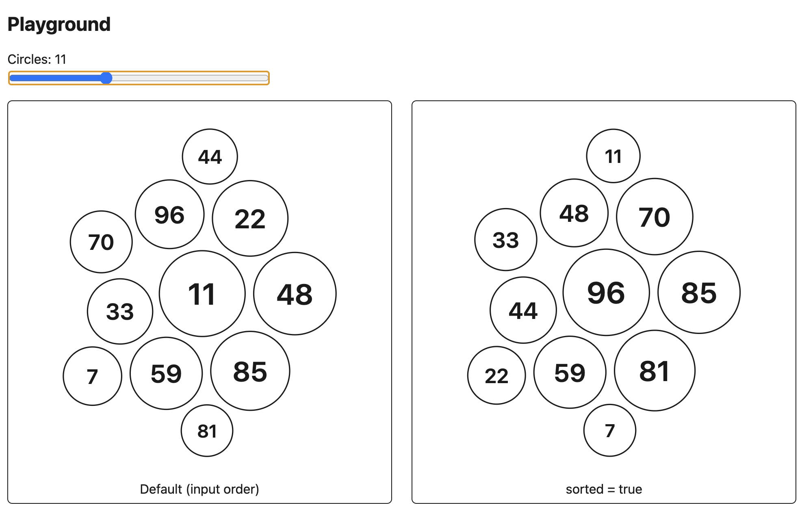

# Gravity Center Experiment

An Angular experiment that shows a list of values as circles packed around a shared center of
gravity. The first (or highest) value sits in the middle, and each value after it moves into the
nearest free spot. This forms a compact, balanced cluster instead of a grid or a list.



The screenshot shows the playground with the same eleven values rendered twice:

- **Default (left):** items keep their input order. The first item (`11`) is the center of
  gravity. Circles get slightly smaller with each position, so the item's place in the list sets
  its size.
- **`sorted = true` (right):** items are ordered from highest to lowest value, and circle size
  follows the value. The highest value (`96`) is the largest circle and sits in the center.
  Values like `85` and `81` stay close to it, and the lowest values end up small and on the edge.

## How the layout works

1. The first circle is placed at the origin.
2. Each next circle is tried in two kinds of candidate spots: touching one placed circle, or
   fitting snugly between two of them. Spots that would overlap an existing circle are dropped.
3. The winner is the spot closest to the first circle. Ties are broken by the spot closest to the
   cluster's centroid, which keeps the shape balanced. This is why two values sit side by side and
   three form a triangle.
4. The finished cluster is centered in a square SVG. Small clusters keep some space around them
   instead of filling the whole panel.

The placement logic is plain TypeScript with no Angular code, in
[`src/app/gravity-cluster/gravity-layout.ts`](src/app/gravity-cluster/gravity-layout.ts).

## Using the component

```html
<app-gravity-cluster [items]="items" [sorted]="true" (itemClick)="onSelect($event)" />
```

| Input / output | Type                              | Default | Description                                                       |
| -------------- | --------------------------------- | ------- | ----------------------------------------------------------------- |
| `items`        | `{ id: number; value: number }[]` | —       | Values to render. Required.                                       |
| `sorted`       | `boolean`                         | `false` | Order by value (highest in the center) and size circles by value. |
| `radius`       | `number`                          | `50`    | Radius of the largest circle, in SVG units.                       |
| `gap`          | `number`                          | `10`    | Space between circles.                                            |
| `decay`        | `number`                          | `0.04`  | How much each circle shrinks by position (when not sorted).       |
| `minRatio`     | `number`                          | `0.6`   | Smallest circle as a fraction of `radius`.                        |
| `itemClick`    | `number` (output)                 | —       | Emits the `id` of the clicked circle.                             |

Each circle is a keyboard-focusable button, so Enter and Space also emit its `id`. When circles
move, they animate to their new positions unless the user has reduced motion turned on. Colors
can be changed with the CSS custom properties `--gravity-cluster-ink`, `--gravity-cluster-fill`,
`--gravity-cluster-hover-fill` and `--gravity-cluster-focus`.

## Development

Start the dev server and open `http://localhost:4200/`. The page shows the concept examples (1,
2, 3, 5 and 9 circles) and the playground, which has a slider for the number of circles.

```bash
npm start
```

Build to `dist/`:

```bash
npm run build
```

Run the unit tests (Vitest):

```bash
npx ng test --watch=false
```
